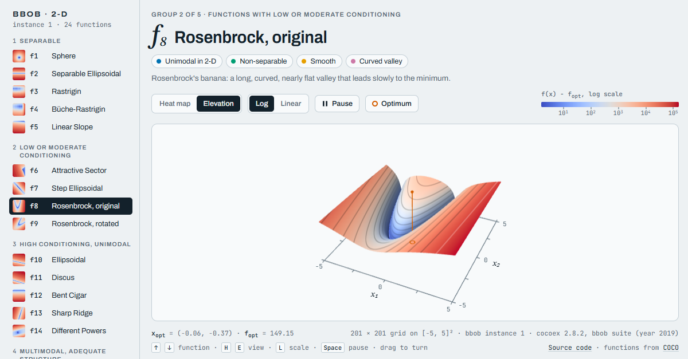

# BBOB Landscape Atlas

**Live:** https://bjbodner.github.io/bbob-landscapes/

An interactive viewer of the 24 noiseless **bbob** benchmark functions of the [COCO platform](https://github.com/numbbo/coco) in two dimensions. Each landscape turns slowly, as a heat map or as an elevation map.

[](https://bjbodner.github.io/bbob-landscapes/)

* **Exact values.** Every landscape is evaluated with `cocoex` on a 201 × 201 grid over the search domain [−5, 5]², for bbob instance 1 (the 2019 suite). Hover over the surface, or tap it, to read x, f(x) − f_opt and f(x) at a grid point.
* **Two views, two scales.** The heat map and the elevation map can each show f(x) − f_opt on a log or a linear scale. Contour lines are drawn at equal steps of the colour scale.
* **The optimum.** It is marked from COCO's own `x_opt`, with its f_opt in the footer.
* **The classification.** Each function shows its bbob group (separable; low or moderate conditioning; high conditioning and unimodal; multimodal with adequate global structure; multimodal with weak global structure) and pills for its modality, separability, local surface, conditioning and global structure, as described in the bbob function definitions [2].
* **Navigation.** Use the side index, the arrow keys, or a link to one function such as [`#f15`](https://bjbodner.github.io/bbob-landscapes/#f15). <kbd>H</kbd> and <kbd>E</kbd> switch the view, <kbd>L</kbd> switches the scale, and <kbd>Space</kbd> pauses the rotation. Drag to turn and tilt.

## Rebuild

```bash
pip install -r requirements.txt
python build.py                 # writes index.html
python build.py --instance 7    # another bbob instance
```

`build.py` fills `template.html` with the grid values, stored as log10(f(x) − f_opt) quantised to 16 bits, and writes a single self-contained `index.html`. The page loads three.js r128 from cdnjs and its fonts from Google Fonts.

`demo/record.mjs` records the 30-second demo video (`node demo/record.mjs video`) and the link-preview image (`node demo/record.mjs preview`). It drives the page in headless Chrome on a fake clock, and needs ffmpeg.

## Optimizer Race

[`race.html`](race.html) replays recorded runs of six optimizers on one bbob function in 2-D, evaluation by evaluation: AMM (amm-optimizer 0.3.0, preset c46), HCMA, SLSQP, Nelder-Mead, NGOpt and CMA-BIPOP.

* **How AMM runs here.** AMM plans for the budget it is given, so with all 2000 evaluations at once it spends its first 20% on a global search, even on an easy function. In the race it therefore runs c46 with budgets of 5, 10, 30 and 100 × D in turn, then the rest, each run starting from the best point so far.
  * `race/tune_amm.py` chose this schedule from 14 candidates on bbob instances 6-15, which the race does not show (`race/tuning/results.json`). There it won 101 of 240 races against SLSQP and HCMA, against 63 for c46 with the whole budget.
  * On the race's own instances 1-5 it wins 36 of 120, up from 27.
  * The algorithm itself is unchanged.

* **On the landscape.** Each × is one evaluation. The last 10 of each optimizer are shown, fading with age. The ring marks each optimizer's best point so far. It never fades, and it glides to a new point only when a better one is found.
* **The track.** Each optimizer's best f(x) − f_opt so far, on a log scale from 10 down to the finish line at 10⁻⁸ (COCO's final target).
* **The finish.** The first to cross wins. When every optimizer on the track has finished, or after 1000 × D = 2000 evaluations, the next function starts.
* **Controls.**
  * The seed (1-5) is the bbob instance.
  * Each optimizer can be switched on or off.
  * Heat map or elevation; muted or Atlas colours; speed.
  * Links like [`race.html#f15-s2`](race.html#f15-s2) open one race.
* **The data.** `race/data/f{f}_i{k}.json` (about 120 kB each) holds the landscape and every recorded sample. It is written by `race/record.py`, with the versions in `race/requirements.txt`.
  * The runs follow the harness of the AMM final test: the same restart loop, uniform start points, stop at the budget or at 10⁻⁸, and seeds derived from (f, k).
  * HCMA cannot be re-run here. Its runs come from the COCO data archive (Loshchilov 2013), which logs every improvement and samples at log-spaced evaluation counts, so the page shows only those samples.
  * Every file stores a SHA-256 of the full-precision trace. `python race/record.py --verify N` re-runs N random runs and compares them.
* **Caveat.** These are single runs, one per optimizer per instance: an illustration, not a benchmark.

The page fetches its data, so serve the folder rather than opening the file: `python -m http.server`, then open `http://localhost:8000/race.html`.

The renderer is shared with the Atlas:
* `src/landscape.js`: the three.js surface, 2-D fallback, overlay canvas and picking.
* `src/bbob-meta.js`: names and classification.
* `src/race.js` and `src/race.css`: the race. `BBOBRace.mount(element, options)` embeds it in another page.

`demo/snap.mjs` takes deterministic screenshots of either page on a fake clock.

## References

1. N. Hansen, A. Auger, R. Ros, O. Mersmann, T. Tušar, D. Brockhoff, *COCO: A platform for comparing continuous optimizers in a black-box setting* (2021), Optimization Methods and Software 36(1).
2. N. Hansen, S. Finck, R. Ros, A. Auger, *Real-Parameter Black-Box Optimization Benchmarking 2009: Noiseless Functions Definitions* (2009), INRIA Research Report RR-6829.

## License

Apache-2.0. three.js is MIT-licensed. COCO is BSD-licensed.
